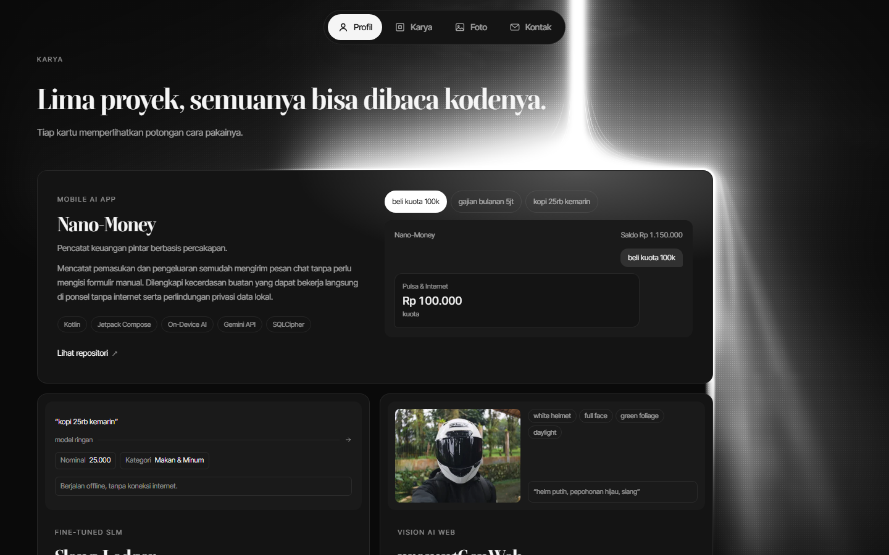
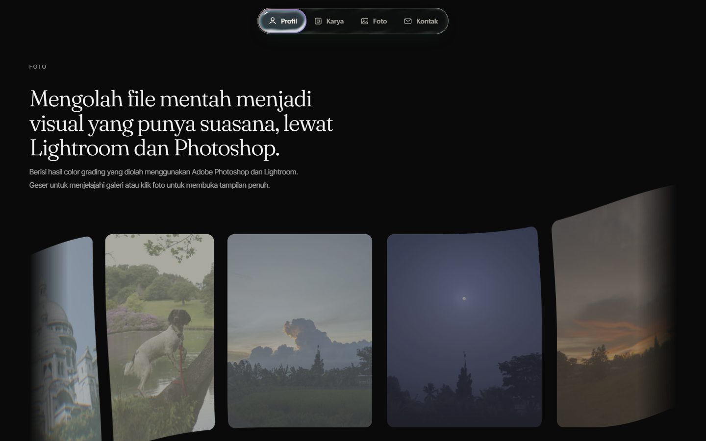

# Portofolio — Yasin Anr

Situs portofolio satu halaman: profil, lima proyek (mobile AI, fine-tuned SLM, computer vision, security tool, full-stack web), dan galeri color grading. Dibangun dengan React + TypeScript + Vite, dengan beberapa bagian yang digambar langsung lewat WebGL/WebGPU.

[](https://snnn-011.github.io/Portofolio/)


## Pratinjau





## Isi halaman

| Seksi | Isi |
| --- | --- |
| **Hero** | Nama besar, latar black hole (WebGPU) dengan fallback gradien statis |
| **Profil & Pendekatan** | Ringkasan singkat cara kerja dan latar studi |
| **Karya** | Kartu 5 proyek dengan pratinjau potongan cara pakai; kartu unggulan disinari berkas laser |
| **Foto** | Galeri geser (drag/wheel/klik) berisi hasil color grading |
| **Kontak** | Tautan sosial dan email |

Navigasi memakai pill polos (`NavPill`) yang mengikuti seksi aktif; di mobile berubah jadi bar ikon. Versi kaca dengan shader air WebGL (`LiquidNavbar`) dipisah ke [repo sendiri](https://github.com/SNNN-011/liquid-navbar) dan tidak dipasang lagi di sini.

## Menjalankan

Butuh Node 20.19+ atau 22.12+.

```bash
npm install
npm run dev      # http://localhost:5173
npm run build    # hasil statis di dist/
npm run preview  # cek hasil build
```

## Struktur

```
src/
  App.tsx                         susun navbar + layer laser + Home
  app.css                         token warna, font (Fraunces + Inter Tight), animasi reveal
  data/projects.ts                5 proyek: nama, tagline, stack, repo
  data/photos.ts                  23 foto galeri
  components/
    sections/Home.tsx             hero, profil, karya, foto, kontak
    sections/Projects.tsx         grid kartu proyek
    sections/Photos.tsx           pembungkus galeri
    ui/nav-pill.tsx               navbar pill polos (dipakai)
    ui/liquid-glass-navbar.tsx    navbar kaca + shader air WebGL (disimpan; repo terpisah)
    ui/black-hole-canvas.tsx      host WebGPU untuk latar hero
    ui/black-hole/                sumber contoh vgpu (dipakai apa adanya)
    ui/laser-card-layer.tsx       penempatan berkas laser di kartu unggulan
    ui/laser-flow/                shader LaserFlow (WebGL2, satu file GLSL)
    ui/flex-carousel/             carousel geser berbasis canvas
    ui/project-previews.tsx       5 pratinjau use-case per proyek
  docs/                           gambar pratinjau untuk README (bukan bagian app)
public/
  assets/photos/                  foto galeri (.webp)
  fonts/                          Fraunces + Inter Tight (subset, self-host)
  icon-*.png                      favicon dari logo Y
```

Dua konteks GPU dipakai berdampingan: **WebGL2** (kartu laser, carousel) dan **WebGPU** (black hole). Keduanya punya jalur cadangan — shader laser dilewati kalau WebGL2 tidak tersedia, dan black hole jatuh ke lapisan gradien.

## Catatan teknis

- **Berkas laser.** Satu shader `LaserFlow` di `ui/laser-flow/LaserFlow.jsx`. Untuk kartu unggulan, kanvasnya dipasang selebar layar mulai dari bawah hero sampai ±560px di bawah kartu, dengan `mask-image` supaya ujungnya tidak terpotong. Di bawah tepi kartu, bentuk tumpahan "dibekukan" pada tinggi tepi lalu dilanjutkan dengan `fall` yang bertambah, sehingga cahayanya turun dan melebar natural, tanpa menyorot garis bawah kartu atau kartu proyek di bawahnya.
- **Posisi sinar** diatur lewat `BEAM_ON_CARD` (rasio lebar kartu) di `laser-card-layer.tsx`, warnanya lewat prop `color`.
- **Font** di-host sendiri di `public/fonts/` (bukan Google Fonts) dan di-preload: Fraunces sudah di-subset dan di-instance di wght 300, Inter Tight tetap variable untuk 400/500. Tidak ada stylesheet pihak ketiga yang memblokir render.
- **Pemuatan bertahap.** Kanvas LaserFlow dan carousel foto diimpor dinamis dan baru dipasang saat elemennya mendekati viewport. Foto galeri (±2,9 MB) tidak diunduh sebelum pengguna mendekati seksi Foto.
- **Navbar.** `NavPill` hanya memakai CSS: tanpa kanvas, `backdrop-filter`, atau animasi yang jalan terus. Versi kaca ber-shader air (`ui/liquid-glass-navbar.tsx`) dipisah ke repo sendiri, [SNNN-011/liquid-navbar](https://github.com/SNNN-011/liquid-navbar), lengkap dengan demo; salinannya tetap ada di sini, cukup tukar impornya di `src/App.tsx` untuk memakai lagi.
- **Bundel awal** hanya berisi React, host black hole, dan konten teks (±93 KB gzip); sisa efek masuk chunk terpisah.

## Deploy

Hosting utama: **GitHub Pages**, otomatis lewat workflow `.github/workflows/deploy.yml` setiap push ke `main`.

- Build memakai `PAGES_BASE=/Portofolio/` supaya aset menunjuk ke sub-path repo (lihat `vite.config.ts`). Build lokal tanpa env itu tetap memakai `/`.
- Alamat: https://snnn-011.github.io/Portofolio/

Karena hasilnya statis murni, `dist/` juga bisa langsung ditaruh di Cloudflare Pages / Vercel / Netlify dengan build command `npm run build` dan output `dist`.

## Lisensi

Kode bebas dipakai sebagai referensi. Teks, foto, dan logo di dalamnya milik Yasin Anr.
